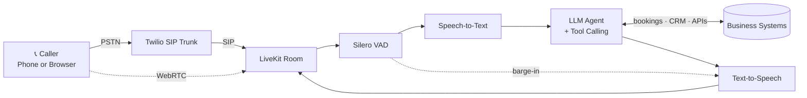
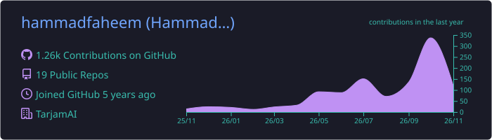
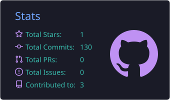
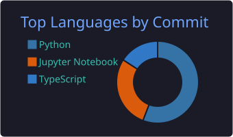

  

  

  
  
  
  
   
  

---

## 👋 About Me

I build voice agents that pick up the phone, hold a natural conversation, and actually get the job done: booking a hotel room, scheduling a plumber, or translating a live sermon into 100+ languages.

I've shipped real-time voice AI to production for teams in 🇺🇸 the US, 🇦🇺 Australia and 🇸🇪 Sweden, mostly on **LiveKit**, **Twilio SIP** and **WebRTC**.

- 🔭 Currently building **TarjamAI**, a live speech-translation platform for masjids that serves 100+ languages in real time
- 🎙️ Specialise in low-latency **STT → LLM → TTS** pipelines, SIP telephony, barge-in handling and tool-calling agents
- 🎓 Pursuing an **MS in Artificial Intelligence** at NED University
- 🧑‍🏫 Taught **3,000+ Data Science & Python lessons** on Preply with a 4.9★ rating
- 💬 Ask me about LiveKit Agents, Twilio SIP trunking, voice latency, or testing voice agents
- 🤝 Open to **Voice AI engineering roles** and **freelance voice-agent projects**

---

## 📈 Impact at a Glance

| ⚡ **< 800 ms** | 📞 **100+** | 🐞 **−35%** | 🌍 **100+** |
|:---:|:---:|:---:|:---:|
| voice response latency with barge-in | concurrent calls on Twilio SIP + LiveKit | production agent error rate | languages translated live |

---

## 🎙️ How I Build Voice Agents

A typical production call flow I design and ship:

---

## 🛠️ Tech Stack

  

| Area | Tools |
|---|---|
| **Voice & Real-time** |         |
| **Agents & LLMs** |       |
| **Vector Stores** |    |
| **Machine Learning** |     |
| **AI Dev Tools** |   |

---

## 🚀 Featured Work

| Project | What it does | Built with |
|---|---|---|
| 🕌 **TarjamAI** 🔒 Product · 2026 | Translates live Friday khutbahs and Islamic sermons into 100+ languages in real time. Detects Quranic verses, hadith and Islamic terms and links them to Quran.com / Sunnah.com instead of relying on free-form machine translation. | Low-latency streaming speech pipeline, live captions |
| 🔧 **MajsterAI** 🔒 Private · 2025 | AI receptionist for plumbers, electricians and contractors. It answers inbound calls, qualifies the job, captures customer details and books the appointment mid-call. | LiveKit Agents, Ultravox, Silero VAD, FastAPI, PostgreSQL, React 18 + Vite, Docker Compose |
| 🏨 **Mews × LiveKit** 🔒 Client work | Voice agent that creates, updates and cancels hotel reservations and pulls guest profiles during live calls, saving ~15 hours of manual work per week. | LiveKit, Python, Mews API, HammingAI |
| 📞 **[AI Calling Agents](https://ai.digitalgraphiks.co.uk/)** | Multilingual inbound/outbound calling agents with real-time interruption handling and sub-800 ms responses. | Twilio SIP, LiveKit, OpenAI, Deepgram, Cartesia |
| 🎟️ **[Tixse](https://www.thetixse.com/)** | Event-ticketing web app with real-time seat selection, secure payments and AI-powered support. | FastAPI, React, PostgreSQL |

<b>More projects</b>

 

| Project | What it does | Built with |
|---|---|---|
| 📊 **[Call Analytics SaaS](https://dg-ai-chatbot-landing.vercel.app/)** | Central dashboard for monitoring AI-driven calls and insights | FastAPI, React, PostgreSQL |
| 🍽️ **[Restaurant AI Bot](https://ai-restaurant-chat.digitalgraphiks.co.uk/)** | Multi-platform assistant that handles restaurant reservations | LangChain, RAG, OpenAI |
| 📚 **[ICAP AI Bot](https://ai.digitalgraphiks.co.uk/)** | Domain-specific Q&A agent for accounting students | Llama-3, FAISS, LangChain |
| 🩺 **Healthcare Chatbots** 🔒 Client work | Multilingual assistants with contextual memory (5 languages, 3,000+ users) | LLMs, multi-agent tool use |

---

## 💼 Experience

**🟢 AI Engineer · TarjamAI** · 🇺🇸 United States (Remote) · *Apr 2026 – Present*
- Engineered a low-latency streaming pipeline from live speech to translated captions that keeps pace with the speaker through long-form sermons
- Built automatic detection of Quranic verses, hadith and Islamic terms, linked to authentic sources

**AI / Python Engineer · SophiieAI** · 🇦🇺 Australia (Remote) · *Nov 2025 – Apr 2026*
- Resolved 40+ critical bugs in production LiveKit voice agents, cutting agent error rates by **35%**
- Integrated the Mews hotel platform so agents handle bookings, changes and cancellations live (**~15 hrs/week** saved)
- Tested agents with HammingAI (**+22%** call-completion accuracy) and kept Python APIs at **99.5%** uptime

**AI Engineer · Omnigate** · 🇸🇪 Sweden (Remote) · *Jul 2025 – Nov 2025*
- Shipped multilingual healthcare chatbots for **3,000+ users** in 5 languages
- Built multi-agent SQL Q&A (**−45%** data-retrieval time) and AI ticketing that deflects **60%** of tickets

**Junior AI Engineer · Digital Graphiks** · 🇵🇰 Karachi · *May 2025 – Oct 2025*
- Designed an STT → LLM → TTS pipeline with barge-in handling and **< 800 ms** response latency
- Integrated Twilio SIP with LiveKit for inbound and outbound calling at **100+ concurrent calls**
- Synced real-time events and context across agents with data channels and async RPC

**AI Engineer Intern · Proxima** · 🇵🇰 Karachi · *Jan 2025 – Apr 2025*
- Built generative-AI support workflows that cut average resolution time by **30%**

**Data Science & Python Instructor · Preply** · 🌐 Remote · *Mar 2022 – Present*
- 3,000+ lessons for 200+ students, including learners from Harvard, Cornell and Johns Hopkins (4.9★)

---

## 🎓 Education & Certifications

| | |
|---|---|
| 🎓 **MS, Artificial Intelligence** | NED University of Engineering & Technology · *2026 – Present* |
| 🎓 **BS, Computer Science (AI & Big Data)** | University of Karachi · *2021 – 2025* |
| 🏅 **Certified AI Developer** | PIAIC (Presidential Initiative for AI & Computing) · *2020 – 2022* |
| 📜 **Building Agentic RAG with LlamaIndex** | DeepLearning.AI |
| 📜 **Building Autonomous Agents** | DeepLearning.AI |
| 📜 **LangChain for LLM Application Development** | DeepLearning.AI |
| 📜 **Machine Learning** | Kaggle / DataCamp |

---

## 📊 GitHub Activity

  

  
  

  

  <picture>
    <source media="(prefers-color-scheme: dark)" srcset="https://raw.githubusercontent.com/hammadfaheem/hammadfaheem/output/github-snake-dark.svg" />
    <source media="(prefers-color-scheme: light)" srcset="https://raw.githubusercontent.com/hammadfaheem/hammadfaheem/output/github-snake.svg" />
    
  </picture>

---

## 🤝 Let's Build Something

Building a voice agent, wiring up SIP telephony, or trying to bring latency down? I'm happy to walk you through a **LiveKit + Twilio SIP** setup on a short call.

📫 [hammadfaheem5@gmail.com](mailto:hammadfaheem5@gmail.com) · 💼 [LinkedIn](https://linkedin.com/in/hammad-faheem-2162601b3)

  <i>"AI systems should feel seamless, not scripted."</i>

  

