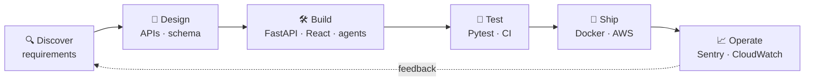

  

  

  
  
  
  
   
  

---

## 👋 About Me

I'm a software engineer who builds AI products and takes them all the way to production: from the first call with a customer, through system design, APIs and databases, to deployment, monitoring and Day-2 support.

My day-to-day is solid backend engineering in **Python and FastAPI**, **React** frontends and **PostgreSQL on AWS**, combined with applied AI: LLM agents, RAG and real-time voice where the product needs it. I've shipped production systems for remote teams in 🇺🇸 the US, 🇦🇺 Australia and 🇸🇪 Sweden.

- 🔭 Currently **AI Engineer at TarjamAI**, owning a B2B real-time translation platform end to end
- 🧱 Comfortable across the stack: async Python services, REST APIs and webhooks, React dashboards, SQL schema design, CI/CD
- 🤝 Customer-facing by habit: I turn fuzzy requirements into technical designs, integrations and shipped features
- 🎓 Pursuing an **MS in Artificial Intelligence** at NED University
- 🧑‍🏫 Mentored 200+ students across **3,000+ Python & data science sessions** (4.9★)
- 💼 Open to **Software Engineer**, **AI Engineer** and **Forward Deployed Engineer** roles

---

## 🧭 What I Do

| 🧱 Software Engineering | 🤖 Applied AI & Agents | 🚀 Forward Deployed |
|---|---|---|
| Full-stack products on **FastAPI**, **React** and **PostgreSQL**. API and schema design, async services, testing, CI/CD and production monitoring. | LLM agents with tool calling, **RAG**, multi-agent orchestration, **MCP**, and real-time **voice AI** on LiveKit and Twilio SIP. | Working directly with customers: discovery, requirements, third-party API integrations, deployment and Day-2 support. |

---

## 📈 Impact at a Glance

| 🟢 **99.5%** | 👥 **3,000+** | 🐞 **−35%** | ⚡ **< 800 ms** |
|:---:|:---:|:---:|:---:|
| uptime on production Python APIs | users on AI products I shipped | production error rate after fixing 40+ critical bugs | end-to-end latency on real-time voice pipelines |

---

## 💼 Experience

### 🟢 AI Engineer · TarjamAI
**🇺🇸 United States (Remote)** · *Apr 2026 – Present*

B2B platform sold to masjids that translates live Friday khutbahs and Islamic sermons into **100+ languages** in real time.

- Own the product end to end: discovery, system architecture, implementation, deployment and Day-2 operations
- Architected a low-latency streaming speech-to-translation pipeline that keeps live captions in sync with the speaker through long-form sermons
- Grounded output in authentic sources by detecting Quranic verses, hadith and Islamic terms mid-speech and linking them to Quran.com and Sunnah.com
- Work directly with masjid administrators to turn their needs into requirements, onboarding flows and a prioritised roadmap

`System Design` `Streaming Pipelines` `Deployment & Monitoring` `Customer Discovery`

### AI / Python Engineer · SophiieAI
**🇦🇺 Australia (Remote)** · *Nov 2025 – Apr 2026*

- Built and maintained Python REST APIs and automation workflows, sustaining **99.5% uptime** across production systems
- Integrated the Mews hotel reservation API as agent tools for creating, updating and cancelling bookings and fetching guest profiles, removing **~15 hours/week** of manual work for hospitality clients
- Diagnosed and fixed **40+ critical production bugs** in LiveKit voice agents, cutting error rates by **35%**
- Introduced automated pre-release testing with HammingAI, raising call-completion accuracy by **22%**

`Python` `REST APIs` `Third-party API Integration` `LiveKit Agents` `Automated Testing`

### AI Engineer · Omnigate
**🇸🇪 Sweden (Remote)** · *Jul 2025 – Nov 2025*

- Shipped multilingual healthcare chatbots with contextual memory, serving **3,000+ users** in **5 languages**
- Built a multi-agent system for question answering over SQL databases, cutting data-retrieval time by **45%**
- Integrated AI ticket triage into the support workflow, deflecting **60%** of tickets away from human agents

`LLM Agents` `Multi-Agent Systems` `SQL` `Tool Calling` `Workflow Integration`

### Junior AI Engineer · Digital Graphiks
**🇵🇰 Karachi, Pakistan** · *May 2025 – Oct 2025*

- Integrated Twilio SIP with LiveKit for inbound and outbound calling, scaling reliably to **100+ concurrent calls**
- Designed a streaming STT → LLM → TTS pipeline with real-time interruption handling at **< 800 ms** latency
- Implemented real-time event streaming and state synchronisation across services using data channels and async RPC

`LiveKit` `Twilio SIP` `WebRTC` `Event Streaming` `Async RPC`

### AI Engineer Intern · Proxima
**🇵🇰 Karachi, Pakistan** · *Jan 2025 – Apr 2025*

- Built generative-AI support workflows with LangChain and RAG, cutting average resolution time by **30%**

`LangChain` `RAG` `LLM Workflows`

### Data Science & Python Instructor · Preply
**🌐 Remote** · *Mar 2022 – Present*

- Mentored **200+ students** through **3,000+** one-to-one Python and data science sessions, including learners from Harvard, Cornell and Johns Hopkins, reviewing their code along the way (4.9★)

`Python` `Data Science` `Machine Learning` `Code Review` `Mentoring`

---

## 🛠️ Tech Stack

  

| Area | Tools |
|---|---|
| **Languages** |     |
| **Backend & APIs** |            |
| **Frontend** |       |
| **Databases** |       |
| **Cloud & DevOps** |            |
| **Testing & Observability** |       |
| **AI & Agents** |          |
| **Voice & Real-time** |        |
| **Machine Learning** |     |
| **AI Dev Tools** |   |
| **Practices** | Agile / Scrum · System Design · Technical Design Docs · Code Review · Production Debugging · Mentoring |

---

## 🔁 How I Ship

---

<b>🧩 Side projects & freelance work</b>

 

- **MajsterAI**: full-stack AI receptionist for trade businesses. FastAPI + PostgreSQL backend, React 18 + Vite dashboard, LiveKit voice agent, shipped as a pnpm monorepo with Docker Compose.
- **[Tixse](https://www.thetixse.com/)**: freelance event-ticketing web app with real-time seat selection that prevents double-booking, payment integration and AI-powered support.

---

## 🎓 Education & Certifications

| | |
|---|---|
| 🎓 **MS, Artificial Intelligence** | NED University of Engineering & Technology · *2026 – Present* |
| 🎓 **BS, Computer Science (AI & Big Data)** | University of Karachi · *2021 – 2025* |
| 🏅 **Certified AI Developer** | PIAIC (Presidential Initiative for AI & Computing) · *2020 – 2022* |
| 📜 **Building Agentic RAG with LlamaIndex** | DeepLearning.AI |
| 📜 **Building Autonomous Agents** | DeepLearning.AI |
| 📜 **LangChain for LLM Application Development** | DeepLearning.AI |
| 📜 **Machine Learning** | Kaggle / DataCamp |

---

## 📊 GitHub Activity

  

  
  

  

  <picture>
    <source media="(prefers-color-scheme: dark)" srcset="https://raw.githubusercontent.com/hammadfaheem/hammadfaheem/output/github-snake-dark.svg" />
    <source media="(prefers-color-scheme: light)" srcset="https://raw.githubusercontent.com/hammadfaheem/hammadfaheem/output/github-snake.svg" />
    
  </picture>

---

## 🤝 Let's Work Together

Need someone to take an AI feature from idea to production, plug it into your existing systems, and keep it reliable once real users arrive? I'd love to hear about it.

📫 [hammadfaheem5@gmail.com](mailto:hammadfaheem5@gmail.com) · 💼 [LinkedIn](https://linkedin.com/in/hammad-faheem-2162601b3)

  <i>"AI systems should feel seamless, not scripted."</i>

  

